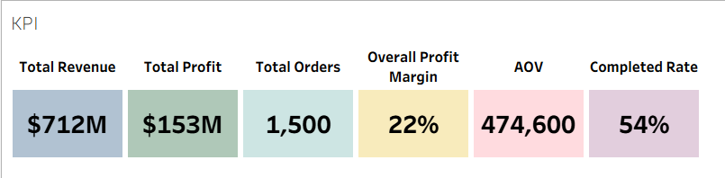
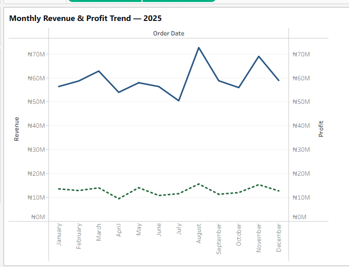
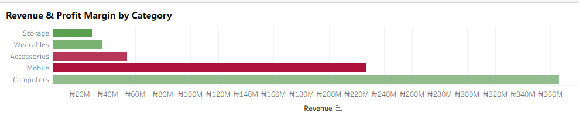
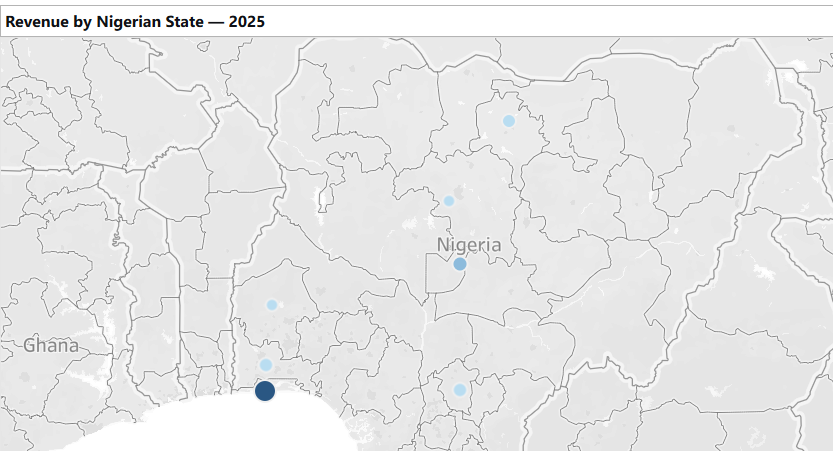
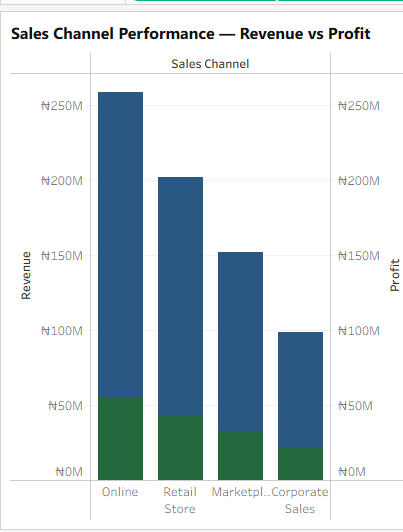
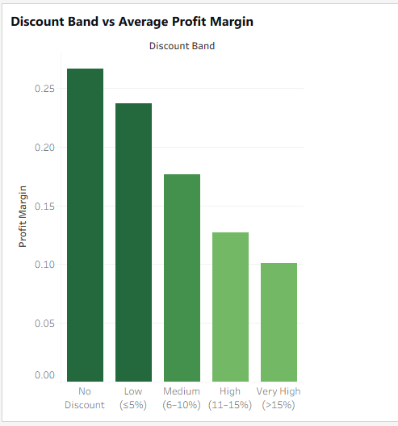
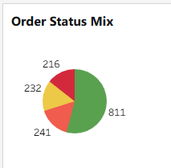
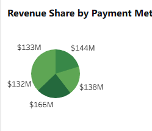

# 📊 Data Visualization Task — CodeAlpha Internship
## Nigerian E-Commerce Sales Dataset (2025)

**Analyst:** Abdulsobur Adebayo

**Tool:** Tableau 

**Dataset:** codealpha_task2_3_sales_eda_visualization.csv (1,500 rows)

**Deliverable:** Interactive dashboard + data story + portfolio-ready visuals

---

## 📑 Table of Contents

1. Project Brief
2. Data Overview & Key Numbers
3. Design System
4. 8 Core Visuals Plan
5. Tableau Build Guide (Step-by-Step)
6. Dashboard Layout
7. The Data Story (5 Acts)
8. Portfolio Packaging for GitHub
9. Deliverables Checklist

---

### 1. Project Brief
The Data Visualization task requires five things. Here's how this project delivers each:

Requirement |	Delivered By
------------| --------------
Transform raw data into visuals|	8 chart types: KPI cards, line, bar, map, donut, grouped bar, treemap, scatter
Use Tableau	| Full step-by-step Tableau Desktop build guide
Design visuals| that reveal insights	Consistent color system, chart-selection matrix, data-ink ratio
Craft compelling data stories|	5-act narrative with executive call-to-action
Build a portfolio	|GitHub repo structure + Tableau Public link + screenshots

---

### 2. Data Overview & Key Numbers
**Dataset Snapshot**
- 1,500 orders across 2025 (Jan 1 → Dec 31)
- 5 categories: Mobile, Computers, Accessories, Storage, Wearables
- 10 regions: Lagos, Abuja, Rivers, Kano, Oyo, Enugu, Kaduna, Ogun, + 2 Unknown
- 4 sales channels: Online, Retail Store, Marketplace, Corporate Sales
- 5 payment methods: Card, Cash, Bank Transfer, USSD, Mobile Money
- 4 order statuses: Completed, Pending, Cancelled, Returned

**Pre-Visualization Calculated Fields**

I created these before building charts:

```
// Core Metrics
[Revenue]        = SUM([revenue])
[Profit]         = SUM([profit])
[Total Cost]     = SUM([cost])
[Orders]         = COUNTD([order_id])

// Derived Ratios
[Profit Margin %] = SUM([profit]) / SUM([revenue])
[AOV]             = SUM([revenue]) / COUNTD([order_id])
[Completion Rate] = 
  COUNTD(IF [order_status] = 'Completed' THEN [order_id] END) / COUNTD([order_id])

// Time Dimensions
[Order Month]     = DATETRUNC('month', [order_date])
[Order Quarter]   = DATETRUNC('quarter', [order_date])

// Discount Band
[Discount Band] =
IF [discount_rate] = 0 THEN 'No Discount'
ELSEIF [discount_rate] <= 0.05 THEN 'Low (≤5%)'
ELSEIF [discount_rate] <= 0.10 THEN 'Medium (6–10%)'
ELSEIF [discount_rate] <= 0.15 THEN 'High (11–15%)'
ELSE 'Very High (>15%)'
END

// Profit Status Flag
[Profit Status] = IF [profit] < 0 THEN 'Loss' ELSE 'Profit' END

// Order Outcome
[Order Outcome] =
IF [order_status] = 'Completed' THEN 'Completed' ELSE 'Leakage' END

```

---
### 3. Design System

To ensure a professional and cohesive presentation, a strict visual language was applied:
- Primary Color: Deep Blue (#0A4D8C) - Used for baseline revenue.
- Success Color: Sea Green (#2E8B57) - Used for profit and positive completions.
- Danger Color: Red (#C0392B) - Used for losses and cancellations.
- Typography: Consistent, highly legible sans-serif fonts (Tableau Book/Bold).


**3.2 Chart Selection Matrix**
Question |	Best Chart
---------|-----------
Trend over time|	Line
Category ranking	| Horizontal bar
Part-to-whole |	Donut (max 5 slices)
Correlation	| Scatter
Geography	| Filled map
Composition + ranking	| Treemap

---

### 4. 8 Core Visuals Plan
**📌 Visual 1 — KPI Summary Cards (Dashboard Top)**
KPI	|Formula
----|-----
Total Revenue|	SUM([revenue])
Total Profit|	SUM([profit])
Profit Margin	|SUM([profit]) / SUM([revenue])
Total Orders|	COUNTD([order_id])
AOV|	SUM([revenue]) / COUNTD([order_id])
Completion Rate|	Completed orders / All orders

Purpose: Instant snapshot for executives



**📈 Visual 2 — Monthly Revenue & Profit Trend**
- X-axis: Order Month
- Y-axis: Dual — SUM(revenue) (solid, blue), SUM(profit) (dashed, green)
- Marks: Line chart
- Insight target: Identify Q4 spikes and margin shifts



**🏷️ Visual 3 — Revenue by Product Category (Horizontal Bar)**
- Rows: category
- Columns: SUM(revenue)
- Sort: Descending
- Color: Gradient by Profit Margin %
- Insight target: Mobile + Computers = ~70% of revenue



**🗺️ Visual 4 — Regional Sales Map (Filled Map)**
- Geography: region (Nigerian states)
- Color: SUM(revenue) (light → dark blue)
- Tooltip: Orders, AOV, Profit Margin
- Insight target: Lagos dominance; northern under-penetration



**🛒 Visual 5 — Sales Channel Performance (Grouped Bar)**
- Rows: sales_channel
- Columns: Side-by-side — SUM(revenue), SUM(profit)
- Insight target: Online = volume leader; Corporate = highest AOV



**🎟️ Visual 6 — Discount Band vs Profit Margin (Bar)**
- X-axis: Discount Band
- Y-axis: AVG(Profit Margin %)
- Color: Diverging (red < 0, green > 0)
- Insight target: Margins collapse above 15% discount



**⚠️ Visual 7 — Order Status Funnel (pie)**
- Slice by: order_status
- Size: COUNTD(order_id)
- Colors: Green (Completed), Orange (Pending), Red (Cancelled / Returned)
- Insight target: ~25% order leakage



**💳 Visual 8 — Payment Method Mix (pie)**
- Slice by: payment_method
- Size: SUM(revenue)
- Insight target: Card + Bank Transfer + Mobile Money = >85%



---

### 7. The Data Story (5 Acts)
**🎬 ACT 1 — "The Business at a Glance"**

In 2025, the business processed 1,500 orders across Nigeria, generating substantial revenue and a healthy double-digit profit margin. But a concerning ~25% of orders end in Cancelled, Returned, or Pending status — meaning 1 in 4 orders never converts to completed revenue. This is the single most important operational signal in the dataset.

Visuals: KPI cards + Order Status pie

**🎬 ACT 2 — "Where the Money Comes From"**

Revenue is heavily concentrated. Mobile and Computers account for the majority of total revenue, while Lagos alone contributes roughly a third of all sales. This is both a strength — clear product-market fit — and a strategic risk. A dip in one category or a disruption in Lagos would materially affect the entire business.

Visuals: Category Bar + Regional Map

**🎬 ACT 3 — "How Customers Actually Buy"**

Online leads in order volume, but Corporate Sales commands the highest average order value — bulk B2B purchases of laptops and monitors. On the payment side, Card, Bank Transfer, and Mobile Money together cover over 85% of transactions. USSD, while widely used, skews heavily toward small-ticket accessories.

Visuals: Channel Grouped Bar + Payment Donut

**🎬 ACT 4 — "The Margin Trap"**

Discounts do work — higher discount bands correlate with larger quantities purchased. But there's a hidden cost: profit margins collapse beyond a 15% discount, and several orders become loss-making. The business is trading margin for volume without a clear payoff. Every additional percentage point of discount beyond 15% eats directly into the bottom line.

Visual: Discount Band vs Profit Margin Bar

**🎬 ACT 5 — "What to Do Next"**

Three moves to protect and grow profit:
- Cap discounts at 15%. Beyond that, margin disappears — enforce this at the POS/pricing engine level.
- Investigate the 25% order leakage. Returns and cancellations likely concentrate in a specific channel or region — cross-filter the dashboard to find them.
- Scale Corporate Sales. Highest AOV, lowest marketing cost, most profitable segment — build a B2B funnel.

Visual: Callout box + Executive Summary Table

