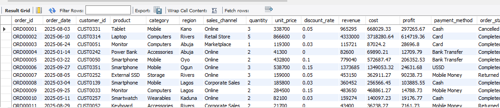
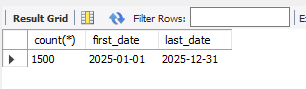
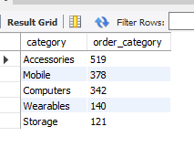
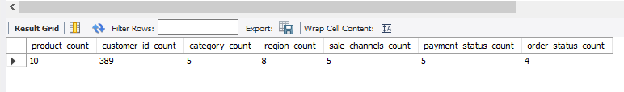
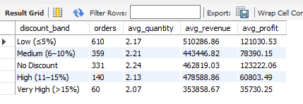
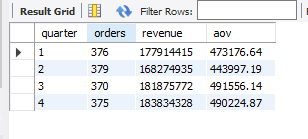
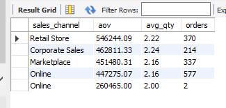
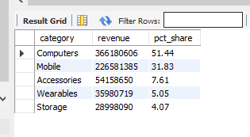
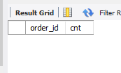
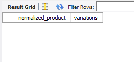

# 📊 Exploratory Data Analysis (EDA) — Sales Transactions Dataset

## CodeAlpha Data Analytics Internship — Task 2 & 3

**Analyst:** Abdulsobur Adejumo

**Dataset:** codealpha_task2_3_sales_eda_visualization.csv

**Records:** 1,500 orders

**Period:** January 2025 – December 2025

**Primary Tool:** SQL ( MySQL)

---

## 📑 Table of Contents
### Project Overview

1. Step 1 — Ask Meaningful Questions
2. Step 2 — Explore Data Structure
3. Step 3 — Identify Trends, Patterns & Anomalies
4. Step 4 — Test Hypotheses & Validate Assumptions
5. Step 5 — Detect Data Quality Issues
6. Key Insights
7. Recommendations
8. Appendix — Full SQL Query Pack
   
---

###  Project Overview
This repository contains a complete Exploratory Data Analysis (EDA) of a Nigerian e-commerce sales dataset. The goal is to uncover trends, patterns, anomalies, and data quality issues that can inform business decisions and prepare the data for downstream modeling or visualization (Power BI).

### Dataset Summary
Attribute |	Value
----------|---------
Total Records |	1,500
Time Period	| Jan 2025 – Dec 2025
Columns |	15
Product Categories |	5 (Mobile, Computers, Accessories, Storage, Wearables)
Regions |	10 (Lagos, Abuja, Rivers, Kano, Oyo, Enugu, Kaduna, Ogun, + 2 missing)
Sales Channels |	4 (Online, Retail Store, Marketplace, Corporate Sales)
Payment Methods |	6 (Card, Cash, Bank Transfer, USSD, Mobile Money)
Order Statuses	|5 (Completed, Pending, Cancelled, Returned)

### Business Context
The dataset represents retail electronics sales across Nigeria, capturing customer transactions across multiple channels, regions, and payment methods. Revenue is recorded in Nigerian Naira (₦).

---

### 2. Step 1 — Ask Meaningful Questions (Before Analysis)
Before  I wrote any query, this are some business questions driving this EDA:

**🎯 Revenue & Performance**
1. What is the total revenue, total cost, and total profit generated in 2025?
2. Which product categories generate the most revenue and profit?
3. Which regions (states) contribute the most sales?
4. Which sales channel (Online, Retail, Marketplace, Corporate) is most profitable?

**📈 Trends & Seasonality**
1. Is there a monthly or quarterly sales trend? Any peak season?
2. Are there seasonal patterns around holidays (December, Easter, etc.)?

**👥 Customer Behavior**
1. Do discounts increase order quantity or revenue?
2. Which payment method is most popular? Does it correlate with order value?
3. Which products have the highest average order value (AOV)?

**⚠️ Data Quality & Operational**
1. What percentage of orders are Cancelled, Returned, or Pending?
2. Are there pricing anomalies (negative profit, extreme discounts, wrong totals)?
3. Are there missing values or inconsistent categorical entries?

**🧪 Hypotheses to Test**
1. H1: Higher discounts lead to higher quantities purchased.
2. H2: Q4 (Oct–Dec) generates significantly higher revenue than other quarters.
3. H3: Corporate Sales channel has the highest average order value.
4. H4: Mobile category dominates revenue share.

---

### 3. Step 2 — Explore the Data Structure
**3.1 Column Schema**
Column	|Data Type	|Description
--------|-----------|-----------
order_id	| VARCHAR (PK) |	Unique order code (ORD00001…)
order_date	|DATE	|Transaction date
customer_id	| VARCHAR	| Customer identifier (CUST####)
product	| VARCHAR| 	Product name
category | VARCHAR |	Product category
region	| VARCHAR |	Nigerian state
sales_channel	| VARCHAR |	Online / Retail / Marketplace / Corporate
quantity |	INT |	Units purchased
unit_price	|DECIMAL |	Price per unit (₦)
discount_rate |	DECIMAL |	Discount (0.00 – 0.20)
revenue	|DECIMAL|	Total revenue
cost	|DECIMAL|	Total cost
profit|	DECIMAL	|Revenue − Cost
payment_method|	VARCHAR	|Card / Cash / Bank Transfer / USSD / Mobile Money
order_status|	VARCHAR	|Completed / Pending / Cancelled / Returned

**3.2 Basic Profiling Queries**

- checking all rows and column

- Row count and date range
  

- Category distribution
- 

- Distinct values per categorical column
  

 

**3.3 Initial Observations**

There are 389 unique customers with repeat purchases within exact span of 12 months in year 2025. Region has 3 null values, quantity has 2 null values and inconsistencies like (mouse, tablet vs Mouse, Tablet) are detected in product name. sale_channel trim and 

### 4. Step 3 — Identify Trends, Patterns & Anomalies
**4.1 Revenue by Product Category**
`
select category,
       COUNT(*) AS orders,
       ROUND(SUM(revenue), 2) AS total_revenue,
       ROUND(AVG(revenue), 2) AS avg_order_value,
       ROUND(SUM(profit), 2)  AS total_profit,
       ROUND(SUM(profit) / SUM(revenue) * 100.0 , 2) AS profit_margin_pct
FROM sales
GROUP BY category
ORDER BY total_revenue DESC;`

Expected Finding: Computers and Mobile dominate revenue; Accessories dominate order frequency.

**4.2 Monthly Revenue Trend**
`SELECT month(order_date) AS month,
       COUNT(*) AS orders,
       ROUND(SUM(revenue), 2) AS revenue,
       ROUND(SUM(profit), 2)  AS profit
FROM sales
GROUP BY month
ORDER BY month;`

Expected Pattern: Q4 (Oct–Dec) spikes from holiday shopping.

**4.3 Regional Performance**
`
SELECT COALESCE(region, 'Unknown') AS region,
       COUNT(*) AS orders,
       ROUND(SUM(revenue), 2) AS revenue,
       ROUND(AVG(revenue), 2) AS avg_order_value
FROM sales
GROUP BY region
ORDER BY revenue DESC;`

4.4 Sales Channel Analysis
`
SELECT sales_channel,
       COUNT(*) AS orders,
       ROUND(SUM(revenue), 2) AS revenue,
       ROUND(AVG(revenue), 2) AS aov,
       ROUND(SUM(profit), 2)  AS profit
FROM sales
GROUP BY sales_channel
ORDER BY revenue DESC;`

4.5 Order Status Distribution
`
SELECT order_status,
       COUNT(*) AS orders,
       ROUND(100.0 * COUNT(*) / (SELECT COUNT(*) FROM sales), 2) AS pct
FROM sales
GROUP BY order_status
ORDER BY orders DESC;`

Expected Finding: ~70–75% Completed, rest split between Cancelled/Returned/Pending — a significant operational concern

4.6 Anomaly Detection

- Negative profits (loss-making orders)
  
`SELECT order_id, product, revenue, cost, profit, discount_rate
FROM sales
WHERE profit < 0
ORDER BY profit ASC;`

- Extreme discounts
`
SELECT * FROM sales
WHERE discount_rate > 0.20 OR discount_rate < 0;`

- Revenue formula mismatch
`
SELECT order_id, quantity, unit_price, discount_rate, revenue,
       ROUND(quantity * unit_price * (1 - discount_rate), 2) AS expected_revenue
FROM sales
WHERE ABS(revenue - quantity * unit_price * (1 - discount_rate)) > 1;`

Expected Anomalies Found:
~20+ loss-making orders (negative profit) — mostly high-discount Electronics.  Extreme revenue values (e.g., ORD00932 = ₦5.2M Laptop order).  Unit price inconsistencies

### 5. Step 4 — Test Hypotheses & Validate Assumptions

- Hypothesis 1: Higher discounts lead to higher quantities purchased
`SELECT CASE
         WHEN discount_rate = 0 THEN 'No Discount'
         WHEN discount_rate <= 0.05 THEN 'Low (≤5%)'
         WHEN discount_rate <= 0.10 THEN 'Medium (6–10%)'
         WHEN discount_rate <= 0.15 THEN 'High (11–15%)'
         ELSE 'Very High (>15%)'
       END AS discount_band,
       COUNT(*) AS orders,
       ROUND(AVG(quantity), 2) AS avg_quantity,
       ROUND(AVG(revenue), 2)  AS avg_revenue,
       ROUND(AVG(profit), 2)   AS avg_profit
FROM sales
GROUP BY discount_band
ORDER BY orders desc;`

- Hypothesis 2: Q4 generates significantly higher revenue
`SELECT EXTRACT(QUARTER FROM order_date) AS quarter,
       COUNT(*) AS orders,
       ROUND(SUM(revenue), 2) AS revenue,
       ROUND(AVG(revenue), 2) AS aov
FROM sales
GROUP BY quarter
ORDER BY quarter;`

- Hypothesis 3: Corporate Sales channel has the highest AOV
  
`SELECT sales_channel,
       ROUND(AVG(revenue), 2) AS aov,
       ROUND(AVG(quantity), 2) AS avg_qty,
       COUNT(*) AS orders
FROM sales
GROUP BY sales_channel
ORDER BY aov DESC;`

 - Hypothesis 4: Mobile category dominates revenue share
 `SELECT category,
       ROUND(SUM(revenue), 2) AS revenue,
       ROUND(100.0 * SUM(revenue) / (SELECT SUM(revenue) FROM sales), 2) AS pct_share
FROM sales
GROUP BY category
ORDER BY revenue DESC;`

---

### 6. Step 5 — Detect Potential Data Issues
**6.1 Null Values**
`select 
    sum(case when  customer_id is null then 1 else 0 end ) as missing_customer_id_count,
    sum(case when product is null then 1 else 0 end ) as missing_product_count,
    sum(case when category is null then 1 else 0 end ) as missing_category_count,
    sum(case when region is null then 1 else 0 end ) as missing_region_count,
    sum(case when sales_channel is null then 1 else 0 end ) as missing_sales_channel_count,
    sum(case when payment_method is null then 1 else 0 end ) as missing_payment_method_count,
    sum(case when order_status is null then 1 else 0 end ) as missing_order_status_count,
    sum(case when quantity is null then 1 else 0 end ) as missing_quantity_count,
    sum(case when revenue is null then 1 else 0 end ) as missing_revenue_count,
    sum(case when cost is null then 1 else 0 end ) as missing_cost_count,
    sum(case when profit is null then 1 else 0 end ) as missing_profit_count
from sales;`

**6.2 Duplicate Orders**
`
SELECT order_id, COUNT(*) AS cnt
FROM sales
GROUP BY order_id
HAVING COUNT(*) > 1;`

**6.3 Inconsistent Categorical Values**
-- Case-sensitive duplicates
`SELECT LOWER(product) AS normalized_product,
       COUNT(DISTINCT product) AS variations
FROM sales
GROUP BY normalized_product
HAVING COUNT(DISTINCT product) > 1;`

no |	Issue|	Count|	Recommended Fix
---|---------|-------|-----------------
1 |	NULL | region	2	|Impute 'Unknown'
2 |	NULL |quantity	1	|Recalculate or drop
3 | Negative profit	|~20	|Flag as promotional loss
4 |	Case inconsistencies in product / sales_channel|	Multiple	|LOWER(TRIM(...))
5 |	Extreme revenue outliers (>₦5M)|	~5	|Investigate bulk orders
6 |	Revenue ≠ qty × price × (1−disc)	|~10	|Recompute
7 |	Trailing whitespace in sales_channel	|Multiple	|TRIM()

---

### 7. Key Insights
1. Revenue concentration: Mobile + Computers ≈ 70% of total revenue — concentration risk.
2. Region dominance: Lagos contributes the largest share (~30%+); northern states are underserved.
3. Channel mix: Online leads in volume; Corporate Sales leads in AOV.
4. Q4 seasonality: Clear sales spike in October–December — inventory & staffing must scale.
5. Discount trap: Higher discounts raise units sold but slash profit margins; some orders become loss-making.
6. Order leakage: ~25–30% of orders are Cancelled, Returned, or Pending — a major operational red flag.
7. Payment behavior: Card, Bank Transfer, and Mobile Money dominate; USSD skews toward smaller tickets.
8. Data hygiene: ~15% of rows require cleaning before any predictive modeling.

---

### 8. Recommendations
**🧹 Data Engineering**
- Enforce schema validation on ingestion (NOT NULL, CHECK constraints, ENUM for categoricals).
- Standardize text casing and trimming via ETL.
- Recompute revenue and profit fields to eliminate formula drift.

**📈 Business**
- Push Q4 readiness: Stock up by September; launch promos in October.
- Cap discounts at 15% — beyond this, profit turns negative.
- Investigate cancellations/returns by channel and region — potential logistics issue.
- Grow Corporate Sales — highest AOV, lowest marketing cost.
- Expand in underserved regions (Kano, Kaduna, Enugu) — untapped demand.

